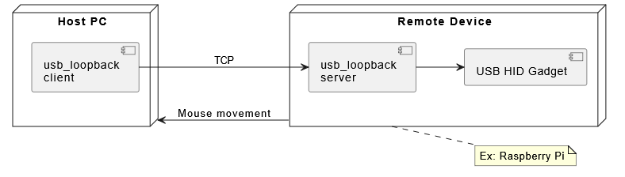

# USB loopback

Sends mouse actions and keystrokes from client to server using TCP sockets.

The server writes HID report to USB device file descriptors.

Adjust `SCREEN_WIDTH` and `SCREEN_HEIGHT` (`client\io_interface.py`) for correct mouse coordinate scaling.



# Installation

```
pip install usb_loopback
```

## Prerequisites

### Server

[USB gadget file descriptors](
https://github.com/joyfully1265/usb_hid.git) (`/dev/hidg0`, `/dev/hidg1` for keyboard, mouse, respsectively, by default)

# Message protocol

Each frame is a single `msg_type` byte followed by a fixed-size payload.
The payload mirrors the HID report structure exactly; the only framing added by this protocol is the leading `msg_type` byte.


| msg_type  | payload                  |
| -- | -- |
| 1 byte    | 4, 6, or 8 bytes         |

## Message structure

| Offset | Size | Field | Description |
| --- | ---: | --- | --- |
| 0 | 1 | `msg_type` | `0` = keyboard, `1` = relative mouse, `2` = absolute mouse |
| 1 | variable | `payload` | Report body; length is determined by `msg_type` |

## `msg_type` values

| Value | Name | Size | Description |
| ---: | --- | ---: | --- |
| 0 | `KEYBOARD` | 8 bytes | HID keyboard report (modifiers, reserved, 6 keycodes) |
| 1 | `MOUSE` | 4 bytes | Relative mouse movement / button state |
| 2 | `MOUSE_ABS` | 6 bytes | Absolute cursor position / button state |

> The server logs and closes the connection on an unrecognized `msg_type`.

## Keyboard payload (`msg_type = 0`)

| Offset | Size | Field | Description |
| --- | ---: | --- | --- |
| 0 | 1 | `modifier_mask` | Bitmask of held modifier keys|
| 1 | 1 | `reserved` | Always `0x00` |
| 2 | 6 | `key_codes[0..5]` | Up to six HID usage IDs; `0x00` = unused slot |

## Relative mouse payload (`msg_type = 1`)

| Offset | Size | Field | Description |
| --- | ---: | --- | --- |
| 0 | 1 | `button_mask` | Button state bitmask (see below) |
| 1 | 1 | `dx` | Relative X movement, `-127..127` |
| 2 | 1 | `dy` | Relative Y movement, `-127..127` |
| 3 | 1 | `wheel` | Scroll delta, `0` |

## Absolute mouse payload (`msg_type = 2`)

| Offset | Size | Field | Description |
| --- | ---: | --- | --- |
| 0 | 1 | `button_mask` | Button state bitmask (see below) |
| 1 | 2 | `x` | Absolute X, `0..32767` |
| 3 | 2 | `y` | Absolute Y, `0..32767` |
| 5 | 1 | `wheel` | Scroll delta, `0` |

Button-only updates (press/release without moving) are sent as `msg_type = 2` with `x = y = 0`.

### Button bits (both mouse types)

| Bit | Mask | Button |
| ---: | ---: | --- |
| 0 | `0x01` | Left |
| 1 | `0x02` | Right |
| 2 | `0x04` | Middle |

## Coordinate scaling

Screen coordinates are converted to the HID range `0..32767` (`0x7FFF`):

```
hid = int(screen_coord / resolution * 32767)
```

where `resolution` is `SCREEN_WIDTH` / `SCREEN_HEIGHT` from `client/io_interface.py`.
